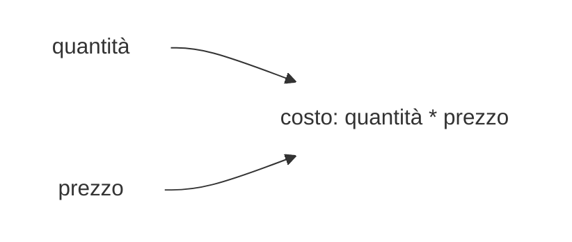
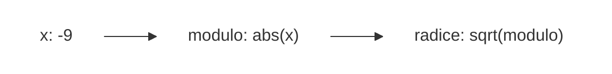
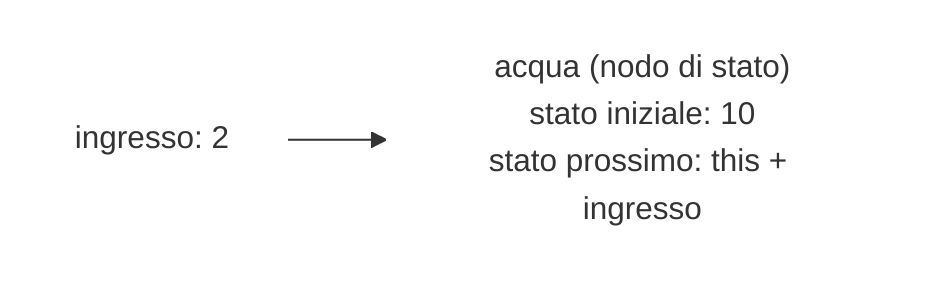
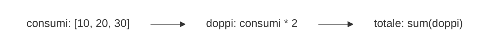

# Pensare per funzioni

Quando costruiamo un modello, scegliamo alcune grandezze e descriviamo le relazioni tra esse. Per esempio, possiamo calcolare il costo di un acquisto a partire dalla quantità acquistata e dal prezzo unitario, oppure descrivere come cambia nel tempo la quantità d’acqua in un serbatoio. Le *funzioni* ci consentono di esprimere queste relazioni in modo preciso e di combinarle in modi sofisticati.

## Dagli argomenti al valore

Una funzione è una regola che stabilisce una relazione tra elementi di due insiemi. La si scrive solitamente

$$
f:X \rightarrow Y
$$

per indicare una relazione $f$ degli elementi dell'insieme $X$, chiamati *argomenti* della funzione, con gli elementi dell'insieme $Y$, chiamati *valori* della funzione.
La condizione che una relazione deve soddisfare per essere una funzione è che per ogni argomento $x \in X$ deve esserci uno e un solo valore $y \in Y$.  
La funzione quadrato, per esempio, associa un numero al quadrato di quel numero, e si scrive abitualmente $f(x)=x^2$.

Si dice che *si valuta una funzione* $f$ per indicare che di un certo argomento $x$ si trova il valore, $y=f(x)$, per esempio $9=f(3)$ (in certi contesti, ma abitualmente non in matematica e non in `STGraphX`, si distingue tra una funzione applicata a un argomento e il valore ottenuto nella valutazione, per esempio scrivendo $f(x)$ nel primo caso e $\text{eval}\,f(x)$ nel secondo).

Una funzione può avere più argomenti. Il costo di un acquisto può essere descritto dalla funzione $c(q,p)=q\,p$, dove $q$ è la quantità acquistata e $p$ il prezzo unitario. In `STGraphX` possiamo rappresentare questa funzione con un grafo

in cui le frecce dai nodi `quantità` e `prezzo` al nodo `costo` rendono visibili la relazione tra i due argomenti e il valore.

## Due notazioni per le funzioni

Abitualmente le funzioni sono scritte in *notazione funzionale*, indicando il nome della funzione seguito dagli argomenti tra parentesi, separati da virgole. Per esempio, in `STGraphX` `pow(x, y)` calcola la potenza di base `x` ed esponente `y`.  
La stessa operazione si può scrivere in *notazione operatoriale* `x ^ y`, in analogia alla forma matematica $x^y$, in cui il simbolo dell’operazione compare tra i suoi argomenti. Le due scritture esprimono lo stesso calcolo:

| Notazione funzionale | Notazione operatoriale | Valore |
| --- | --- | --- |
| `pow(2, 3)` | `2 ^ 3` (cioè $2^3$) | `8` |
| `pow(3, 2)` | `3 ^ 2` (cioè $3^2$) | `9` |

L’ordine degli argomenti è dunque importante: nell'esempio, la base e l’esponente hanno ruoli diversi.  
Anche le operazioni come `+` e `*` sono dunque funzioni, scritte in notazione operatoriale: ricevono due argomenti e producono un valore. Scrivere `3 + 4` è un modo familiare per applicare la funzione somma.  
Le due notazioni possono convivere nella stessa espressione, per esempio `pow(x, 2) + 1`.

La gran parte delle funzioni non ha un simbolo operatoriale corrispondente: per esempio, per calcolare il logaritmo di $x$ in base $y$ in matematica scriviamo $\log_y(x)$ e `log(x,y)` in `STGraphX`.

## Comporre funzioni

Spesso il valore prodotto da una funzione diventa l’argomento di un’altra. Questa operazione si chiama *composizione*.

Supponiamo di voler calcolare la radice quadrata del valore assoluto di un numero. In `STGraphX` possiamo scrivere `sqrt(abs(-9))`.  
Il calcolo procede dall’interno verso l’esterno: `abs(-9)` restituisce `9`, che diventa l’argomento di `sqrt`; il risultato finale è `3`. Questa forma di composizione è detta *annidamento*, o *nesting*.

`STGraphX` ammette un secondo modo di scrivere la stessa funzione composta mediante una *pipeline*: `-9 |> abs(_) |> sqrt(_)`.  
Qui leggiamo i passaggi da sinistra verso destra. Il simbolo `|>` passa il valore precedente all’espressione successiva; il segnaposto `_` indica dove usarlo: prima trasformiamo `-9` in `9`, poi `9` in `3`.

Analogamente, `3 |> _ + 1 |> _ * 2` ha come risultato `8`: si parte da `3`, si aggiunge `1` e si moltiplica il risultato per `2`. La stessa trasformazione, scritta con espressioni annidate, è `(3 + 1) * 2`.

Ciò mostra che quando una funzione composta è scritta in forma annidata le parentesi sono essenziali per specificare come si compongono le operazioni. Senza parentesi, `3 + 1 * 2` vale `5` perché la moltiplicazione ha *precedenza* sull’addizione. Nelle usuali espressioni aritmetiche, le potenze hanno precedenza su moltiplicazioni e divisioni, che a loro volta precedono addizioni e sottrazioni. Le parentesi permettono di indicare un ordine di valutazione diverso: in `(3 + 1) * 2`, il risultato della somma diventa il primo argomento della moltiplicazione.

Comporre funzioni consente dunque costruire una trasformazione complessa a partire da trasformazioni più semplici. In `STGraphX` lo si può fare direttamente in un’espressione oppure si possono distribuire i passaggi tra più nodi collegati, dando un nome ai risultati intermedi. Questa seconda possibilità è utile quando quei risultati hanno un significato nel modello o comunque li si vuole osservare separatamente.

Il calcolo `sqrt(abs(-9))`, per esempio, può essere distribuito su tre nodi:

in cui i valori dei nodi sono rispettivamente `-9`, `9` e `3`. Il grafo rende visibile la stessa composizione espressa dal nesting e dalla pipeline.

## Funzioni pure ed effetti collaterali

Una funzione è detta *pura* quando il suo valore dipende soltanto dagli argomenti e il suo calcolo non produce *effetti collaterali* (*side effects*).

Sono due condizioni distinte:

- a parità di argomenti, la funzione restituisce lo stesso valore;
- calcolare quel valore non modifica gli argomenti, altre variabili o l’ambiente esterno.

La funzione quadrato è pura: applicata a `3`, restituisce sempre `9`, e il calcolo non cambia nulla altrove. Una procedura che calcolasse un costo e contemporaneamente registrasse un acquisto in un archivio avrebbe invece un effetto collaterale. Eseguirla due volte potrebbe registrare due acquisti, anche se il valore restituito fosse identico.

La purezza facilita il ragionamento. Per capire un’applicazione di funzione basta conoscere la regola e i suoi argomenti; non occorre ricostruire che cosa sia accaduto prima. Possiamo verificare separatamente piccoli calcoli e poi combinarli. Quando componiamo funzioni pure, anche la trasformazione risultante è pura.

Non ogni operazione disponibile in un ambiente di modellazione ha queste proprietà. Per esempio, chiamate successive a `rand()` possono restituire numeri diversi, pur avendo la stessa lista vuota di argomenti. Occorre quindi riconoscere quali informazioni, oltre agli argomenti scritti, intervengano nel calcolo.

## Quando il modello ha memoria

Molti sistemi hanno un comportamento che dipende dalla loro storia. Per sapere quanta acqua ci sarà in un serbatoio dopo un intervallo di tempo, non basta conoscere quanta ne entra: serve anche sapere quanta ce n’è già. Questa informazione costituisce lo *stato* del sistema.

Consideriamo un modello in cui, a ogni passo, aggiungiamo una quantità `ingresso`: $s_{t+1}=s_t+ingresso_t$.

In un nodo di stato di `STGraphX` possiamo impostare lo stato iniziale a `10` e lo stato prossimo all’espressione `this + ingresso`, in cui `this` rappresenta il valore corrente del nodo. Se `ingresso` vale sempre `2`, gli stati successivi sono `10`, `12`, `14`, `16` e così via.

La memoria appartiene al nodo `acqua`: il riferimento `this` ne rende disponibile lo stato corrente nel calcolo dello stato prossimo.

Dal punto di vista del solo ingresso esterno, il comportamento sembra un’eccezione alla regola «stessi argomenti, stesso valore»: con ingresso `2` otteniamo risultati diversi, perché cambia lo stato interno.

Possiamo però rendere esplicita questa dipendenza scrivendo la funzione di transizione come $T(s,u)=s+u$. Questa funzione può essere perfettamente pura: dati lo stesso stato $s$ e lo stesso ingresso $u$, produce sempre lo stesso stato successivo. Il sistema conserva poi il risultato e lo usa come stato corrente al passo seguente.

È quindi utile distinguere **il calcolo dello stato successivo** dalla **memorizzazione e dall’aggiornamento dello stato**. `STGraphX` rende visibile questa distinzione attraverso lo stato iniziale e l’espressione di transizione dei nodi di stato.

## Le dipendenze dalle variabili globali

Un’espressione può dipendere anche da valori disponibili nel contesto generale del modello. In `STGraphX`, per esempio, `time` indica il tempo corrente. L’espressione `sin(time)` può produrre valori diversi durante una simulazione.

La funzione `sin` resta pura: riceve un argomento e ne calcola il seno. È l’argomento `time` a cambiare. Se considerassimo invece l’intera espressione come un calcolo senza ingressi, trascureremmo una dipendenza essenziale.

Una variabile globale è accessibile senza doverla passare ogni volta come argomento esplicito di una funzione. Questa comodità può rendere meno evidente da che cosa dipenda un risultato. Se una regola usa un valore globale modificabile, mantenere uguali i soli argomenti espliciti non basta a garantire lo stesso risultato.

Leggere un valore globale non è, di per sé, un effetto collaterale: non lo modifica. Introduce però una dipendenza dal contesto. Quando ragioniamo su un modello, dobbiamo perciò chiederci quali informazioni siano necessarie al calcolo, comprese quelle che la scrittura lascia implicite.

## Funzioni non scalari

Gli argomenti e i valori di una funzione non devono essere necessariamente singoli numeri, detti *scalari*. Possono essere anche vettori o matrici.

Un vettore raccoglie più valori in una sequenza ordinata. Potremmo rappresentare i consumi di tre abitazioni con `[10, 20, 30]`.

In `STGraphX`, l’espressione `[10, 20, 30] * 2` restituisce `[20, 40, 60]`: la moltiplicazione per lo scalare viene applicata a ogni elemento. Invece, `sum([10, 20, 30])` restituisce `60`. Nel primo caso la trasformazione produce un vettore; nel secondo produce uno scalare.

Possiamo combinare queste operazioni: `[10, 20, 30] |> _ * 2 |> sum(_)`. Il risultato è `120`. Il principio della composizione resta lo stesso: il valore prodotto da un passaggio diventa l’argomento del successivo. Occorre però che ogni passaggio accetti il tipo e la forma del valore ricevuto.

Qui `consumi` e `doppi` hanno valori vettoriali, mentre `totale` ha un valore scalare. Una freccia può quindi rappresentare la dipendenza da un intero vettore.

Anche lo stato di un modello può essere un vettore, per esempio per rappresentare la quantità d’acqua in più serbatoi. La funzione di transizione trasforma allora un intero stato vettoriale nello stato successivo.

Il concetto di funzione offre così un modo uniforme per leggere un modello: individuare gli argomenti, capire la trasformazione, riconoscere il valore prodotto e rendere esplicite le dipendenze da stato e contesto. Sono domande applicabili sia a una singola espressione sia a un grafo composto da molti nodi.
